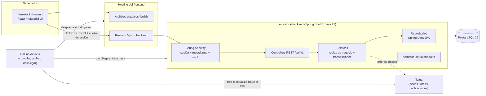
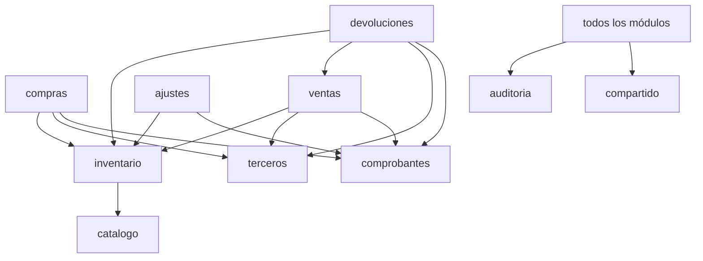

# 01 — Arquitectura de FerreStock

| Campo | Valor |
|---|---|
| **Proyecto** | FerreStock — Sistema web de inventario para ferretería |
| **Nombre** | 01_arquitectura.md |
| **Descripción** | Vista general de la arquitectura: componentes, capas del backend, módulos funcionales, comunicación entre repositorios y despliegue lógico. |
| **Fecha de creación** | 2026-10-14 |
| **Fecha de actualización** | 2026-10-14 |
| **Autores** | Ana Sofía Nagles García · María Mercedes Rincón Valencia · Juan David Camacho Tapiero |
| **Versión** | 0.1.0 |
| **Estado** | Aprobado por el equipo (2026-10-14) |

---

> **Fuente de verdad:** los documentos de `docs/fase-1-analisis/` (v0.2.0). Cada elemento de este diseño se marca como:
> **[C]** confirmado en la Fase 1 · **[D]** derivado del diseño · **[P]** propuesta pendiente de aprobación · **[F]** fuera de alcance.

## 1. Estilo arquitectónico

- **[C]** La aplicación es **un monolito por capas**: Controller → Service → Repository. No hay microservicios, mensajería ni arquitectura hexagonal (RES-08, RNF-MAN-01).
- **[D]** El backend se organiza **por módulo funcional** y, dentro de cada módulo, por capa. Así cada equipo o integrante puede trabajar un módulo completo sin chocar con los demás.
- **[C]** Hay **dos repositorios**: `ferrestock-backend` y `ferrestock-frontend` (RES-06).

## 2. Componentes

| Componente | Responsabilidad | Marca |
|---|---|---|
| Frontend (SPA) | Pantallas, formularios con Formik + Yup, idioma es/en, manejo de sesión en el cliente. No guarda credenciales ni tokens. | [C] |
| Hosting del frontend | Sirve el build estático y **reenvía `/api/**` al backend**, para que el navegador vea un **único origen**. | [P] ADR-04 |
| Backend | API REST JSON, reglas de negocio, seguridad, internacionalización de mensajes, auditoría. | [C] |
| PostgreSQL | Persistencia transaccional. Las restricciones `CHECK` y `UNIQUE` son la última barrera de integridad. | [C] |
| Taiga | Gestión del proyecto: backlog, tareas, issues automáticos de CI y errores, notificaciones y métricas. | [C] |
| GitHub Actions | Detectar cambios, compilar, probar, desplegar o reportar a Taiga. | [P] ADR-16 |

## 3. Módulos funcionales del backend

Paquete base: **`com.ferrestock`**

| Módulo (paquete) | Responsabilidad | Requisitos | ¿Persistencia propia? |
|---|---|---|---|
| `autenticacion` | Iniciar y cerrar sesión, sesión actual, cambio de contraseña | RF-AUT-001 a 004, 007, 008 | No (usa `usuarios`) |
| `usuarios` | Cuentas y roles | RF-AUT-006 | Sí: `usuario` |
| `catalogo` | Categorías, productos y precios | RF-PRO-*, RF-PRE-* | Sí: `categoria`, `producto` |
| `terceros` | Clientes y proveedores en una sola entidad | RF-TER-* | Sí: `tercero` |
| `inventario` | Existencias, kardex, CPP y valorización; **único módulo que escribe movimientos** | RF-INV-*, RF-COS-* | Sí: `movimiento_inventario` |
| `compras` | Registro y anulación de compras | RF-COM-* | Sí: `compra`, `compra_linea` |
| `ventas` | Registro de ventas con pago en efectivo, y anulación | RF-VEN-*, RF-PAG-* | Sí: `venta`, `venta_linea` |
| `devoluciones` | Devoluciones de clientes con validación por línea | RF-DEV-* | Sí: `devolucion`, `devolucion_linea` |
| `ajustes` | Ajustes de inventario exclusivos del Administrador | RF-AJU-* | Sí: `ajuste` |
| `comprobantes` | Consecutivos y datos de los comprobantes imprimibles | RF-DOC-* | Sí: `consecutivo` |
| `auditoria` | Registro y consulta de eventos | RF-AUD-* | Sí: `auditoria` |
| `monitoreo` | Registro de errores y reporte a Taiga; métricas en la Fase 7 | RF-MON-005, 006 | Sí: `registro_error` |
| `compartido` | Errores globales, respuesta paginada, validadores, utilidades de dinero y cantidad, i18n | Transversal | No |
| `configuracion` | Seguridad, OpenAPI, i18n, Jackson, CORS | Transversal | No |

**Dependencias permitidas entre módulos** [D]:

- Los módulos se comunican **llamando a servicios**, nunca accediendo al repositorio de otro módulo.
- `inventario` expone `MovimientoInventarioService` con operaciones como `registrarEntrada(...)` y `registrarSalida(...)`. Es el único punto que modifica `existencias` y `costo_promedio`, lo que garantiza que RN-01 y RN-04 se apliquen en un solo lugar.

## 4. Responsabilidades por capa

| Capa | Hace | No hace |
|---|---|---|
| `controller` | Recibir HTTP, validar DTO (`@Valid`), aplicar `@PreAuthorize`, invocar el servicio y devolver el código HTTP. | Lógica de negocio; acceso a repositorios. |
| `service` | Casos de uso, reglas de negocio, transacciones (`@Transactional`), auditoría y conversión entre entidades y DTO. | Devolver `ResponseEntity`; conocer HTTP. |
| `repository` | Interfaces Spring Data JPA y consultas JPQL con parámetros. | Lógica de negocio. |
| `entity` | Entidades JPA con Lombok (`@Getter`, `@Setter`, `@NoArgsConstructor`, `@Builder`). No se usa `@Data` en entidades con relaciones. | Exponerse directamente en la API. |
| `dto/solicitud`, `dto/respuesta` | Contratos JSON de entrada y salida, como `record` de Java con anotaciones de Bean Validation. | Contener entidades. |

## 5. Despliegue lógico

| Entorno | Frontend | Backend | Base de datos |
|---|---|---|---|
| Desarrollo | `npm run dev` (Vite, puerto 5173) con proxy `/api` → `localhost:8080` | `mvn spring-boot:run` con perfil `dev` | PostgreSQL local o en Docker |
| Pruebas (CI) | Build + Playwright contra el backend levantado en el job | `mvn verify` con perfil `test` | PostgreSQL efímero (Testcontainers) |
| Demostración | Hosting estático gratuito con reenvío `/api` | Plataforma gratuita para contenedores o JAR | PostgreSQL gestionado gratuito, sin puerto público |

Las plataformas concretas se eligen en la Fase 6 (DP-14).
