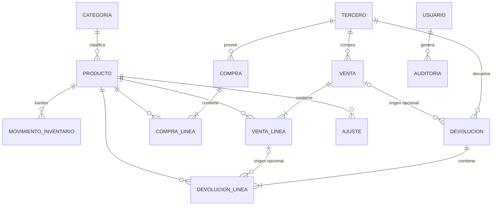

# 02 — Modelo de datos (PostgreSQL)

| Campo | Valor |
|---|---|
| **Proyecto** | FerreStock — Sistema web de inventario para ferretería |
| **Nombre** | 02_modelo_de_datos.md |
| **Descripción** | Modelo entidad-relación y diccionario de datos de PostgreSQL: tablas, tipos, restricciones, índices, relaciones, eliminación lógica y reglas de concurrencia. |
| **Fecha de creación** | 2026-10-14 |
| **Fecha de actualización** | 2026-10-14 |
| **Autores** | Ana Sofía Nagles García · María Mercedes Rincón Valencia · Juan David Camacho Tapiero |
| **Versión** | 0.1.0 |
| **Estado** | Aprobado por el equipo (2026-10-14) |

---

## 1. Diagrama entidad-relación

La fuente versionable del diagrama está en [modelo-er.mmd](modelo-er.mmd); aquí se muestran solo las relaciones.

## 2. Convenciones

| Convención | Regla |
|---|---|
| Nombres | Tablas y columnas en español, `snake_case`, en singular. |
| Clave primaria | `id BIGINT GENERATED ALWAYS AS IDENTITY`, salvo `consecutivo`. |
| Fechas | `TIMESTAMPTZ`, guardadas en UTC y mostradas en `America/Bogota`. |
| Dinero (COP) | `NUMERIC(14,2)`; en Java, `BigDecimal` con redondeo `HALF_UP` (RNF-ADF-01). |
| Costos unitarios y CPP | `NUMERIC(16,4)`. |
| Cantidades | `NUMERIC(14,3)`. Si el producto no permite fracción, el servicio exige escala 0 (ADR-10). |
| Enumeraciones | `VARCHAR` + `CHECK`, mapeadas con `@Enumerated(EnumType.STRING)`. Es más fácil de migrar que los `ENUM` nativos. |
| Columnas de control (tablas maestras) | `creado_en`, `actualizado_en` (`TIMESTAMPTZ NOT NULL`), `creado_por_id`, `actualizado_por_id` (FK → `usuario`, admiten NULL solo en los datos iniciales). |
| Borrado | **No hay `DELETE`** en tablas con historial. Las FK usan `ON DELETE RESTRICT` y `ON UPDATE RESTRICT`. |
| Esquema | Se crea con scripts SQL versionados en `ferrestock-backend/db/`; Hibernate usa `ddl-auto=validate` (RNF-FLX-02). |

## 3. Diccionario de datos

### 3.1 `usuario` — cuentas del sistema (RF-AUT)

| Columna | Tipo | Nulo | Restricciones / notas |
|---|---|:---:|---|
| id | BIGINT identity | No | PK |
| nombre_usuario | VARCHAR(50) | No | UNIQUE (índice sobre `lower(nombre_usuario)`); `CHECK (nombre_usuario ~ '^[a-z0-9._-]{3,50}$')` |
| nombre_completo | VARCHAR(120) | No | |
| password_hash | VARCHAR(100) | No | BCrypt con fuerza 12 (RNF-SEG-01) |
| rol | VARCHAR(20) | No | `CHECK (rol IN ('ADMIN','OPERATIVO'))` |
| activo | BOOLEAN | No | DEFAULT TRUE; eliminación lógica |
| intentos_fallidos | SMALLINT | No | DEFAULT 0 (RF-AUT-008) |
| bloqueado_hasta | TIMESTAMPTZ | Sí | |
| debe_cambiar_password | BOOLEAN | No | DEFAULT TRUE; obliga a cambiar la contraseña inicial |
| idioma | VARCHAR(5) | No | DEFAULT 'es'; `CHECK (idioma IN ('es','en'))` |
| + columnas de control | | | |

### 3.2 `persistent_logins` — tokens de "Recordarme" (RF-AUT-002)

Es la tabla estándar de Spring Security (`JdbcTokenRepositoryImpl`): `username VARCHAR(64) NOT NULL`, `series VARCHAR(64) PK`, `token VARCHAR(64) NOT NULL`, `last_used TIMESTAMP NOT NULL`. Al cerrar sesión se borran los tokens del usuario. Esta es la única tabla con `DELETE`, porque no es historial de negocio.

### 3.3 `categoria` (RF-PRO-004; resuelve DP-05)

| Columna | Tipo | Nulo | Restricciones / notas |
|---|---|:---:|---|
| id | BIGINT identity | No | PK |
| nombre | VARCHAR(60) | No | UNIQUE sobre `lower(nombre)` |
| activa | BOOLEAN | No | DEFAULT TRUE |
| + columnas de control | | | |

El script de datos iniciales carga categorías de ejemplo, como Herramientas manuales, Eléctricos, Plomería, Pinturas, Tornillería y Construcción.

### 3.4 `producto` (RF-PRO, RF-PRE, RF-INV, RF-COS)

| Columna | Tipo | Nulo | Restricciones / notas |
|---|---|:---:|---|
| id | BIGINT identity | No | PK |
| codigo | VARCHAR(30) | No | UNIQUE sobre `upper(codigo)`; `CHECK (codigo ~ '^[A-Za-z0-9-]{2,30}$')` (RNP-01) |
| nombre | VARCHAR(120) | No | `CHECK (length(trim(nombre)) >= 2)` |
| descripcion | VARCHAR(500) | Sí | |
| categoria_id | BIGINT | No | FK → `categoria(id)` |
| unidad_medida | VARCHAR(15) | No | `CHECK IN ('UNIDAD','METRO','KILOGRAMO','LITRO','GALON','CAJA','PAQUETE','ROLLO')` |
| permite_fraccion | BOOLEAN | No | DEFAULT FALSE (p. ej. cable por metro = TRUE) |
| precio_venta | NUMERIC(14,2) | No | `CHECK (precio_venta > 0)` (RNP-03) |
| existencias | NUMERIC(14,3) | No | DEFAULT 0; **`CHECK (existencias >= 0)`** (RN-01, última barrera) |
| costo_promedio | NUMERIC(16,4) | No | DEFAULT 0; `CHECK (costo_promedio >= 0)` |
| estado | VARCHAR(10) | No | DEFAULT 'ACTIVO'; `CHECK IN ('ACTIVO','INACTIVO')` (RN-02) |
| version | BIGINT | No | DEFAULT 0; `@Version` para bloqueo optimista en ediciones |
| + columnas de control | | | |

- **Índices:** `(categoria_id, estado)` para el listado filtrado (RF-PRO-004); `lower(nombre) varchar_pattern_ops` para la búsqueda por prefijo.
- `existencias` y `costo_promedio` **solo los modifica** `MovimientoInventarioService` (ADR-07). Ningún DTO de entrada los incluye.

### 3.5 `tercero` — clientes y proveedores (RF-TER; resuelve DP-06)

| Columna | Tipo | Nulo | Restricciones / notas |
|---|---|:---:|---|
| id | BIGINT identity | No | PK |
| tipo_persona | VARCHAR(10) | No | `CHECK IN ('NATURAL','JURIDICA')` |
| tipo_documento | VARCHAR(5) | No | `CHECK IN ('CC','CE','NIT')` |
| numero_documento | VARCHAR(20) | No | Solo dígitos: `CHECK (numero_documento ~ '^[0-9]{5,15}$')` |
| digito_verificacion | CHAR(1) | Sí | Obligatorio si el tipo es NIT; se valida con el algoritmo módulo 11 de la DIAN en el servicio |
| nombre | VARCHAR(150) | No | Nombre completo o razón social |
| telefono | VARCHAR(20) | Sí | |
| correo | VARCHAR(120) | Sí | Validado con `@Email` |
| direccion | VARCHAR(200) | Sí | |
| es_cliente | BOOLEAN | No | DEFAULT FALSE |
| es_proveedor | BOOLEAN | No | DEFAULT FALSE |
| activo | BOOLEAN | No | DEFAULT TRUE (RNP-06) |
| + columnas de control | | | |

- **Restricciones:**
  - `UNIQUE (tipo_documento, numero_documento)` (RNP-02).
  - `CHECK (es_cliente OR es_proveedor)`.
  - `CHECK (tipo_persona = 'NATURAL' OR tipo_documento = 'NIT')`: una persona jurídica solo puede tener NIT.
  - `CHECK ((tipo_documento = 'NIT') = (digito_verificacion IS NOT NULL))`.
- **Índices:** `lower(nombre) varchar_pattern_ops`; índices parciales `WHERE es_cliente` y `WHERE es_proveedor` para los selectores.

### 3.6 `compra` y `compra_linea` (RF-COM)

**`compra`**

| Columna | Tipo | Nulo | Notas |
|---|---|:---:|---|
| id | BIGINT identity | No | PK |
| consecutivo | VARCHAR(20) | No | UNIQUE (p. ej. `COM-000123`) |
| proveedor_id | BIGINT | No | FK → `tercero`; el servicio verifica `es_proveedor` y `activo` |
| fecha | TIMESTAMPTZ | No | DEFAULT now() |
| observacion | VARCHAR(300) | Sí | |
| total | NUMERIC(14,2) | No | `CHECK (total >= 0)` |
| estado | VARCHAR(10) | No | `CHECK IN ('REGISTRADA','ANULADA')` |
| motivo_anulacion | VARCHAR(300) | Sí | `CHECK ((estado='ANULADA') = (motivo_anulacion IS NOT NULL))` |
| anulada_por_id, anulada_en | BIGINT, TIMESTAMPTZ | Sí | |
| creado_por_id, creado_en | | No | **Documento histórico: solo se modifica `estado` al anularlo** |

**`compra_linea`**

| Columna | Tipo | Nulo | Notas |
|---|---|:---:|---|
| id | BIGINT identity | No | PK |
| compra_id | BIGINT | No | FK → `compra` |
| producto_id | BIGINT | No | FK → `producto` |
| cantidad | NUMERIC(14,3) | No | `CHECK (cantidad > 0)` |
| costo_unitario | NUMERIC(16,4) | No | `CHECK (costo_unitario >= 0)` |
| subtotal | NUMERIC(14,2) | No | cantidad × costo_unitario, redondeado |

`UNIQUE (compra_id, producto_id)`: no se repite el producto en una compra (DP-19).

### 3.7 `venta` y `venta_linea` (RF-VEN, RF-PAG; ADR-05)

**`venta`**

| Columna | Tipo | Nulo | Notas |
|---|---|:---:|---|
| id | BIGINT identity | No | PK |
| consecutivo | VARCHAR(20) | No | UNIQUE (`VEN-000123`) |
| cliente_id | BIGINT | No | FK → `tercero` (RN-05) |
| fecha | TIMESTAMPTZ | No | |
| total | NUMERIC(14,2) | No | `CHECK (total > 0)` |
| medio_pago | VARCHAR(10) | No | `CHECK (medio_pago = 'EFECTIVO')` (RN-06) |
| valor_recibido | NUMERIC(14,2) | No | `CHECK (valor_recibido >= total)` |
| cambio | NUMERIC(14,2) | No | `CHECK (cambio = valor_recibido - total)` |
| estado | VARCHAR(10) | No | `CHECK IN ('REGISTRADA','ANULADA')` |
| motivo_anulacion, anulada_por_id, anulada_en | | Sí | Igual que en `compra` |
| creado_por_id, creado_en | | No | |

**`venta_linea`**

| Columna | Tipo | Nulo | Notas |
|---|---|:---:|---|
| id | BIGINT identity | No | PK |
| venta_id | BIGINT | No | FK → `venta` |
| producto_id | BIGINT | No | FK → `producto` |
| cantidad | NUMERIC(14,3) | No | `CHECK (cantidad > 0)` |
| precio_unitario | NUMERIC(14,2) | No | Precio vigente al vender (se conserva aunque cambie después: CA-PRE-01) |
| costo_unitario | NUMERIC(16,4) | No | **CPP vigente al vender**: costo histórico, distinto del CPP actual (RF-COS-004) |
| subtotal | NUMERIC(14,2) | No | |
| cantidad_devuelta | NUMERIC(14,3) | No | DEFAULT 0; `CHECK (cantidad_devuelta BETWEEN 0 AND cantidad)` (RNP-04) |

`UNIQUE (venta_id, producto_id)`.

### 3.8 `devolucion` y `devolucion_linea` (RF-DEV)

**`devolucion`**: `id`, `consecutivo` UNIQUE (`DEV-…`), `cliente_id` FK, `venta_id` FK **NULL** (RN-07), `motivo VARCHAR(300) NOT NULL` con `CHECK (length(trim(motivo)) >= 5)`, `fecha`, `validada_por_id` FK `usuario` NOT NULL, `creado_por_id`, `creado_en`. Si `venta_id` no es nulo, el servicio verifica que la venta pertenezca al mismo cliente y esté REGISTRADA.

**`devolucion_linea`**

| Columna | Tipo | Nulo | Notas |
|---|---|:---:|---|
| id | BIGINT identity | No | PK |
| devolucion_id | BIGINT | No | FK |
| producto_id | BIGINT | No | FK |
| venta_linea_id | BIGINT | Sí | FK → `venta_linea`; obligatorio si la devolución tiene venta |
| cantidad | NUMERIC(14,3) | No | `CHECK (cantidad > 0)` |
| resultado | VARCHAR(10) | No | `CHECK IN ('ACEPTADA','RECHAZADA')` |
| costo_unitario | NUMERIC(16,4) | Sí | Costo con el que reingresó; solo se llena si fue ACEPTADA (ver 03_inventario_y_costos.md) |

### 3.9 `ajuste` (RF-AJU)

`id`, `consecutivo` UNIQUE (`AJU-…`), `producto_id` FK, `tipo VARCHAR(10) CHECK IN ('ENTRADA','SALIDA')`, `cantidad NUMERIC(14,3) CHECK > 0`, `costo_unitario NUMERIC(16,4) NOT NULL CHECK >= 0`, `motivo VARCHAR(300) NOT NULL` con `CHECK (length(trim(motivo)) >= 5)`, `fecha`, `creado_por_id` (siempre ADMIN, verificado en el servicio), `creado_en`. Inmutable.

### 3.10 `movimiento_inventario` — kardex (RF-INV-002, RF-INV-003)

| Columna | Tipo | Nulo | Notas |
|---|---|:---:|---|
| id | BIGINT identity | No | PK |
| producto_id | BIGINT | No | FK |
| tipo | VARCHAR(25) | No | `CHECK IN ('COMPRA','VENTA','DEVOLUCION','AJUSTE_ENTRADA','AJUSTE_SALIDA','ANULACION_COMPRA','ANULACION_VENTA')` |
| naturaleza | VARCHAR(7) | No | `CHECK IN ('ENTRADA','SALIDA')` |
| cantidad | NUMERIC(14,3) | No | `CHECK (cantidad > 0)` |
| costo_unitario | NUMERIC(16,4) | No | Costo con el que entra o sale |
| saldo_resultante | NUMERIC(14,3) | No | `CHECK (saldo_resultante >= 0)` |
| costo_promedio_anterior | NUMERIC(16,4) | No | Permite revertir el CPP al anular (ver documento 03) |
| costo_promedio_resultante | NUMERIC(16,4) | No | |
| documento_tipo | VARCHAR(12) | No | `CHECK IN ('COMPRA','VENTA','DEVOLUCION','AJUSTE')` |
| documento_id | BIGINT | No | Id del documento origen (referencia polimórfica, sin FK) |
| usuario_id | BIGINT | No | FK → `usuario` |
| fecha | TIMESTAMPTZ | No | DEFAULT now() |

- **Índices:** `(producto_id, id DESC)` para el kardex; `(documento_tipo, documento_id)` para la trazabilidad desde el documento.
- **Inmutable:** un trigger `BEFORE UPDATE OR DELETE` lanza una excepción (ADR-15).

### 3.11 `consecutivo` (RF-DOC-001; ADR-09)

| Columna | Tipo | Notas |
|---|---|---|
| tipo_documento | VARCHAR(12) PK | 'COMPRA', 'VENTA', 'DEVOLUCION', 'AJUSTE' |
| prefijo | VARCHAR(5) NOT NULL | 'COM', 'VEN', 'DEV', 'AJU' |
| siguiente | BIGINT NOT NULL | `CHECK (siguiente >= 1)` |

Se lee con `SELECT … FOR UPDATE` **dentro de la misma transacción del documento**: si la transacción falla, el número no se consume y no quedan huecos (DP-11).

### 3.12 `auditoria` (RF-AUD; RN-11)

| Columna | Tipo | Nulo | Notas |
|---|---|:---:|---|
| id | BIGINT identity | No | PK |
| usuario_id | BIGINT | Sí | FK; nulo en un login fallido con un usuario inexistente |
| nombre_usuario | VARCHAR(50) | No | Nombre escrito o del usuario autenticado |
| fecha | TIMESTAMPTZ | No | DEFAULT now() |
| accion | VARCHAR(40) | No | Código estable, p. ej. `VENTA_REGISTRADA`, `PRECIO_MODIFICADO`, `LOGIN_FALLIDO` |
| descripcion | VARCHAR(500) | No | Texto legible |

- **Índices:** `(fecha DESC)`, `(usuario_id, fecha DESC)`.
- **Inmutable:** trigger que impide `UPDATE` y `DELETE` (RF-AUD-003).
- Los campos son exactamente los de RN-11 más el código de acción para filtrar. No se guardan IP ni valores anteriores (MO-01 sigue como mejora opcional).

### 3.13 `registro_error` (RF-MON-006)

`id`, `correlacion UUID UNIQUE NOT NULL`, `fecha`, `ruta VARCHAR(200)`, `metodo VARCHAR(7)`, `tipo VARCHAR(150)` (clase de la excepción), `mensaje VARCHAR(500)` (sin datos sensibles), `usuario_id NULL`, `taiga_ref VARCHAR(30) NULL` (número del issue creado). El detalle de las métricas se diseña en la Fase 7.

## 4. Datos iniciales (`db/02_datos_iniciales.sql`)

- Un usuario `admin` con contraseña temporal **leída de una variable de entorno al instalar**, nunca escrita en el repositorio, y `debe_cambiar_password = TRUE`.
- Las filas de `consecutivo` y las categorías de ejemplo.
- Opcional, solo en el perfil `dev`: `db/90_datos_demo.sql` con productos y terceros ficticios.

## 5. Concurrencia y transacciones

| Operación | Mecanismo |
|---|---|
| Venta, ajuste de salida, anulación de compra | Transacción `READ COMMITTED` + `SELECT … FOR UPDATE` de los productos **ordenados por id** (evita interbloqueos), validación de existencias y actualización. Si algo se escapa, el `CHECK (existencias >= 0)` aborta. |
| Compra, devolución, ajuste de entrada | Mismo bloqueo, para que el CPP se calcule sobre un saldo consistente. |
| Edición de producto desde la interfaz | `@Version` (optimista): si otro usuario o una venta lo modificó, responde 409 y la interfaz pide recargar. |
| Consecutivos | Bloqueo de fila en `consecutivo` (sección 3.11). |
