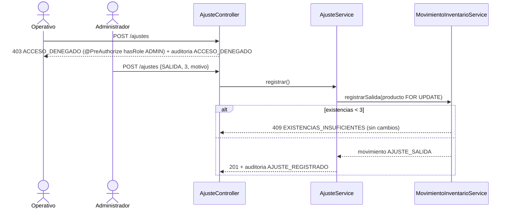
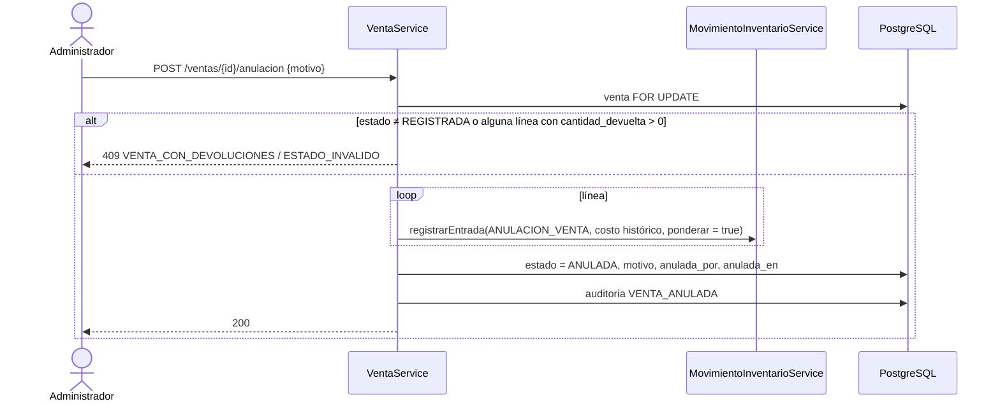
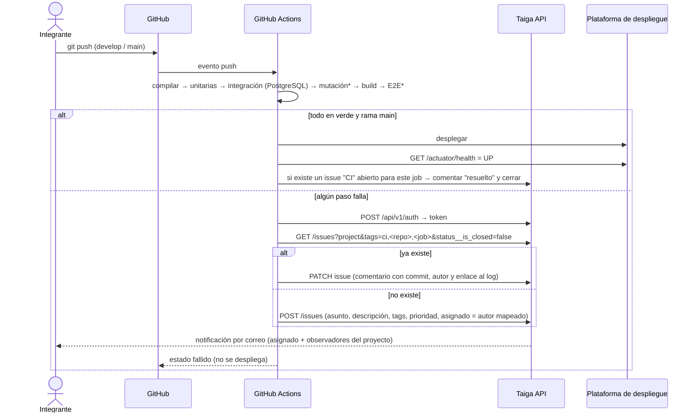

# 07 — Flujos críticos (diagramas de secuencia)

| Campo | Valor |
|---|---|
| **Proyecto** | FerreStock — Sistema web de inventario para ferretería |
| **Nombre** | 07_flujos_criticos.md |
| **Descripción** | Diagramas de secuencia en Mermaid de las operaciones críticas: inicio de sesión con "Recordarme", venta concurrente, compra, devolución, ajuste, anulación y reporte de fallos a Taiga. |
| **Fecha de creación** | 2026-10-14 |
| **Fecha de actualización** | 2026-10-14 |
| **Autores** | Ana Sofía Nagles García · María Mercedes Rincón Valencia · Juan David Camacho Tapiero |
| **Versión** | 0.1.0 |
| **Estado** | Aprobado por el equipo (2026-10-14) |

---

## 1. Inicio de sesión y "Recordarme" (CU-01; CA-AUT-01 a 03)

```mermaid
sequenceDiagram
    actor U as Usuario
    participant F as Frontend
    participant S as Spring Security
    participant A as AutenticacionController
    participant DB as PostgreSQL
    F->>S: GET /api/v1/auth/csrf
    S-->>F: 204 + cookie XSRF-TOKEN
    U->>F: usuario, contraseña, [x] Recordarme
    F->>A: POST /auth/login (X-XSRF-TOKEN)
    A->>DB: buscar usuario (activo, bloqueado_hasta)
    alt credenciales válidas
        A->>S: authenticate() + guardar SecurityContext en la sesión
        A->>DB: intentos_fallidos = 0; INSERT auditoria LOGIN_EXITOSO
        opt recordarme = true
            S->>DB: INSERT persistent_logins (serie, token)
            S-->>F: Set-Cookie FSRECUERDAME (7 días)
        end
        A-->>F: 200 SesionResponse + Set-Cookie FSSESSION
    else inválidas
        A->>DB: intentos_fallidos + 1 (bloquear si llega a 5); auditoria LOGIN_FALLIDO
        A-->>F: 401 CREDENCIALES_INVALIDAS (mensaje genérico)
    end
    Note over F,S: Días después: FSSESSION ya expiró, pero FSRECUERDAME sigue vigente
    F->>S: GET /auth/sesion (cookie FSRECUERDAME)
    S->>DB: validar serie y token; rotar el token
    S-->>F: 200 + nueva FSSESSION (sin volver a escribir la contraseña)
```

## 2. Venta con pago en efectivo y concurrencia (CU-06; CA-VEN-01 a 03)

```mermaid
sequenceDiagram
    actor U as Operativo
    participant F as Frontend
    participant VC as VentaController
    participant VS as VentaService
    participant MS as MovimientoInventarioService
    participant CS as ConsecutivoService
    participant DB as PostgreSQL
    U->>F: cliente, líneas, efectivo recibido
    F->>VC: POST /ventas
    VC->>VC: @Valid VentaRequest; @PreAuthorize(ADMIN, OPERATIVO)
    VC->>VS: registrar(request, usuario)
    activate VS
    Note over VS,DB: @Transactional (una sola transacción)
    VS->>DB: cliente activo y es_cliente
    VS->>DB: SELECT productos … ORDER BY id FOR UPDATE
    VS->>VS: validar ACTIVO, fracciones y existencias ≥ cantidad
    alt alguna línea sin existencias
        VS-->>VC: ExistenciasInsuficientesException
        VC-->>F: 409 EXISTENCIAS_INSUFICIENTES (ROLLBACK)
    else todo válido
        VS->>VS: precio vigente → subtotales → total; valorRecibido ≥ total → cambio
        VS->>CS: siguiente("VENTA") [FOR UPDATE en consecutivo]
        VS->>DB: INSERT venta + venta_linea (costo_unitario = CPP vigente)
        loop por cada línea
            VS->>MS: registrarSalida(producto, cantidad, VENTA, ventaId)
            MS->>DB: INSERT movimiento; UPDATE producto.existencias
        end
        VS->>DB: INSERT auditoria VENTA_REGISTRADA
        VS-->>VC: VentaResponse
        VC-->>F: 201 (consecutivo, total, cambio)
    end
    deactivate VS
    Note over VS,DB: Una segunda venta simultánea del mismo producto espera en FOR UPDATE,<br/>luego ve el saldo nuevo y recibe 409 si ya no alcanza. Las existencias nunca quedan negativas.
```

## 3. Compra con varias líneas y CPP (CU-05; CA-COM-01, CA-COS-01)

```mermaid
sequenceDiagram
    participant F as Frontend
    participant CS as CompraService
    participant MS as MovimientoInventarioService
    participant DB as PostgreSQL
    F->>CS: POST /compras {proveedorId, lineas[]}
    Note over CS,DB: @Transactional
    CS->>DB: proveedor activo y es_proveedor
    CS->>CS: sin productos repetidos; cantidad > 0; costo ≥ 0
    CS->>DB: productos ORDER BY id FOR UPDATE (todos ACTIVOS)
    CS->>DB: consecutivo COMPRA; INSERT compra + líneas
    loop línea
        CS->>MS: registrarEntrada(producto, q, c, COMPRA, ponderar = true)
        MS->>MS: Q' = Q + q ; C' = (Q·C + q·c) / Q'
        MS->>DB: INSERT movimiento (C anterior, C'); UPDATE producto
    end
    CS->>DB: auditoria COMPRA_REGISTRADA
    CS-->>F: 201 CompraResponse
```

## 4. Devolución con validación por línea (CU-08; CA-DEV-01 a 03)

```mermaid
sequenceDiagram
    participant F as Frontend
    participant DS as DevolucionService
    participant MS as MovimientoInventarioService
    participant DB as PostgreSQL
    F->>DS: POST /devoluciones {clienteId, ventaId?, motivo, lineas[resultado]}
    Note over DS,DB: @Transactional
    opt con venta
        DS->>DB: venta REGISTRADA del mismo cliente; venta_linea FOR UPDATE
        DS->>DS: devuelta + cantidad ≤ vendida (solo en líneas ACEPTADAS)
    end
    DS->>DB: consecutivo DEVOLUCION; INSERT devolución + líneas
    loop línea ACEPTADA
        alt con venta
            DS->>MS: registrarEntrada(c = costo histórico de la línea, ponderar = true)
            DS->>DB: venta_linea.cantidad_devuelta += cantidad
        else sin venta
            DS->>MS: registrarEntrada(c = CPP vigente, ponderar = false)
        end
    end
    DS->>DB: auditoria DEVOLUCION_REGISTRADA (o DEVOLUCION_SIN_VENTA), validada_por
    DS-->>F: 201
```

## 5. Ajuste autorizado y rechazado (CU-09; CA-AJU-01 a 04)



## 6. Anulación de una venta (RF-VEN-006 [P])



## 7. Pipeline: desplegar o reportar a Taiga (CU-13; CA-MON-01, 02)



\* La mutación (PIT) y el E2E completo se ejecutan en `main` y en los pull requests hacia `main`, para ahorrar minutos gratuitos (ver 08_repositorios_y_entrega.md).
